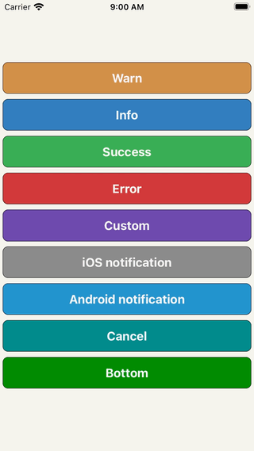

# react-native-dropdownalert

[](https://reactnative.dev)
[](https://www.npmjs.com/package/react-native-dropdownalert)
[](https://www.npmjs.com/package/react-native-dropdownalert)
[](https://raw.github.com/testshallpass/react-native-dropdownalert/master/LICENSE)
[](https://github.com/testshallpass/react-native-dropdownalert/actions/workflows/ci.yml)



## Table of contents

- [Installation](#installation)
- [Usage](#usage)
- [DropdownAlertProps](./DropdownAlert.tsx)
- [Support](#support)
- [Caveats](#caveats)
- [More Examples](./example/App.tsx)

## Installation

- `yarn add react-native-dropdownalert`
- `npm i react-native-dropdownalert --save`

## Usage

```tsx
import React from 'react';
import { Button } from 'react-native';

// Step 1: Import DropdownAlert
import DropdownAlert, { DropdownAlertData } from 'react-native-dropdownalert';

export default function Example(): React.JSX.Element {
  // Step 2: Create ref to hold alert function property.
  const alertRef = React.useRef(
    (data: DropdownAlertData) =>
      new Promise<DropdownAlertData>(res => res(data)),
  );

  return (
    <>
      {/* Step 4: Depending on your use case, use alertRef to display alert */}
      <Button
        title={'Alert'}
        onPress={() =>
          alertRef.current({
            title: 'My alert title',
            message: 'My alert message',
          })
        }
      />
      {/* Step 5: Add DropdownAlert as the last component in the document tree so it overlaps other components. */}
      <DropdownAlert alert={func => (alertRef.current = func)} />

      {/* Alternatively, can pass children instead of using pre-defined or use child prop. */}
      <DropdownAlert>{/* insert your component(s) */}</DropdownAlert>
    </>
  );
}
```

## Support

| react minium version | react-native minium version | package version | reason              |
| :------------------: | :-------------------------: | :-------------: | ------------------- |
|       v16.8.0        |           v0.61.0           |     v5.0.0      | use react hooks     |
|       v16.0.0        |           v0.50.0           |     v3.2.0      | use `SafeAreaView`  |
|   v16.0.0-alpha.6    |           v0.44.0           |     v2.12.0     | use `ViewPropTypes` |

## Caveats

- Modals can overlap `DropdownAlert` if it is not inside the modal's document tree.
- It is important you place the `DropdownAlert` below the `StackNavigator`.

> Inspired by: [RKDropdownAlert](https://github.com/cwRichardKim/RKDropdownAlert)
